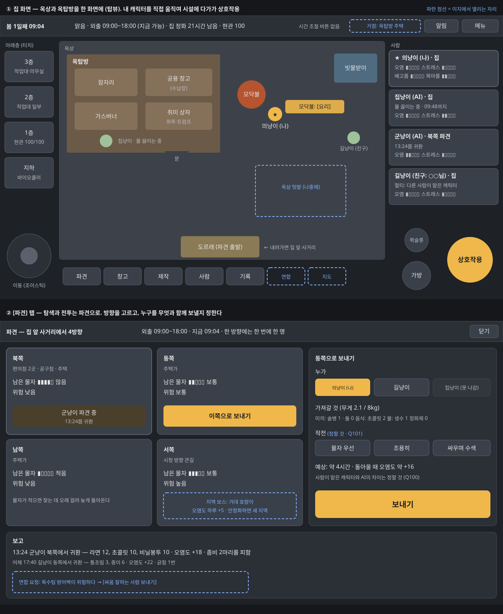

# 화면 배치

첫 버전 3단계 시험판을 써 본 뒤(2026-11-08) 다시 짠 화면 배치다. 나중에 이지 모드(연합, AI팀, 지역 보스, 거점 이전)로 넘어갈 것을 생각해서 자리를 미리 비워 둔다.

## 정해진 것 (확정, 2026-11-08)

- **시간을 빠르게 하는 기능은 없다.** 멀티에서 호스트가 시간을 마음대로 바꾸면 안 되기 때문이다. 밤은 모두 잠자리에 들면 넘어간다.
- **옥상과 옥탑방은 한 화면**이다. 탑뷰로 보여 준다.
- **탐색과 전투는 파견 형식**이다. 바깥을 하나하나 직접 돌아다니지 않는다.
- 아래층(3층, 2층, 1층, 지하)은 아이콘으로 터치해서 쓴다 (앞서 확정, Q46).
- 시험판처럼 모든 UI를 한 화면에 담은 것은 작동 확인용이었다.

## 배치안 (제안, 확인 필요)

### ① 집 화면

| 자리 | 내용 |
|---|---|
| 가운데 (가장 크게) | 옥상과 옥탑방 탑뷰. 옥탑방 안에 잠자리, 공용 창고(수납장), 가스버너, 취미 상자. 옥상에 모닥불, 빗물받이, 도르래(파견 출발), 나중에 텃밭 |
| 조작 | 내 캐릭터를 조이스틱으로 움직여 시설에 다가가면 상호작용 버튼이 그 시설의 일로 바뀐다 (모닥불 → 요리, 수납장 → 창고, 잠자리 → 자기, 도르래 → 파견) |
| 왼쪽 | 아래층 아이콘 4개 (3층 작업대·의무실, 2층, 1층 현관, 지하 바이오쿨러) |
| 오른쪽 | 사람 카드 4장: 누가 맡았는지(나, AI, 친구 ○○님), 어디 있는지, 하는 일, 오염도·스트레스·배고픔·목마름 |
| 위 | 날짜와 시각(조절 버튼 없음), 날씨, 외출 가능 시간, 집 정화 남은 시간, 현관. 알림, 메뉴 |
| 아래 | 메뉴: 파견, 창고, 제작, 사람, 기록. 메뉴를 누르면 그 화면이 위에 겹쳐 뜬다 |

### ② 파견 화면 (아래 메뉴 [파견])

| 자리 | 내용 |
|---|---|
| 왼쪽 | 4방향 카드: 지역 이름, 남은 물자(고갈), 위험, 지금 나가 있는 사람과 귀환 시각 |
| 오른쪽 | 보내기: 누가, 가져갈 것(미끼, 음식, 물, 정화제, 무게), 작전, 예상 시간과 오염도 |
| 아래 | 보고: 돌아온 사람이 가져온 것, 오염도, 마주친 좀비와 결과 |

### 이지 모드에서 열리는 자리

그림의 파란 점선이다. 튜토리얼에서는 숨기거나 잠가 둔다.

| 자리 | 이지에서 쓰는 곳 |
|---|---|
| 위: 거점 이름 | 거점 이전 뒤 지금 거점 |
| 아래 메뉴: 연합 | AI팀 목록, 우호도, 공물, 요청, 인원 맞바꾸기 |
| 아래 메뉴: 지도 | 지역과 안정화, 새 지역, 다른 거점 |
| 파견 카드 | 지역 보스 표시 (거대 호랑이, 오염도 하루 +5) |
| 보고 | 연합 지원 요청 (방어벽 위험 → 싸움 잘하는 사람 보내기) |

## 정할 것

- 이 배치로 갈지 (Q105)
- 사람이 맡은 캐릭터의 파견이 AI 파견과 무엇이 다른지 (Q100), 전투를 어떻게 정할지 (Q101)
- 공격키·퀵슬롯과 전투 프롤로그 (Q102), 시간 초과 귀환 (Q103), 혼자일 때 일시정지 (Q104)
